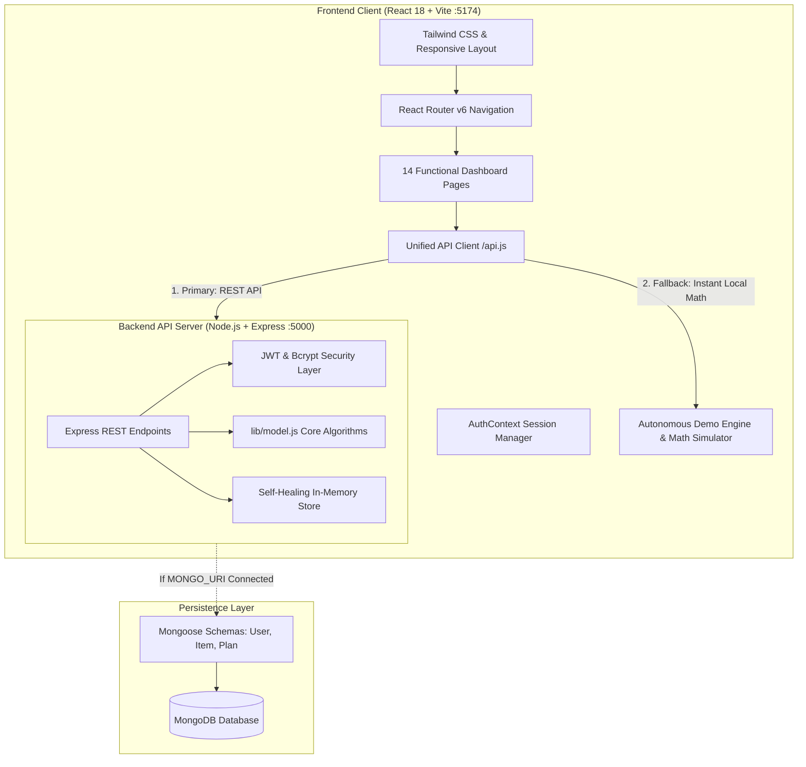
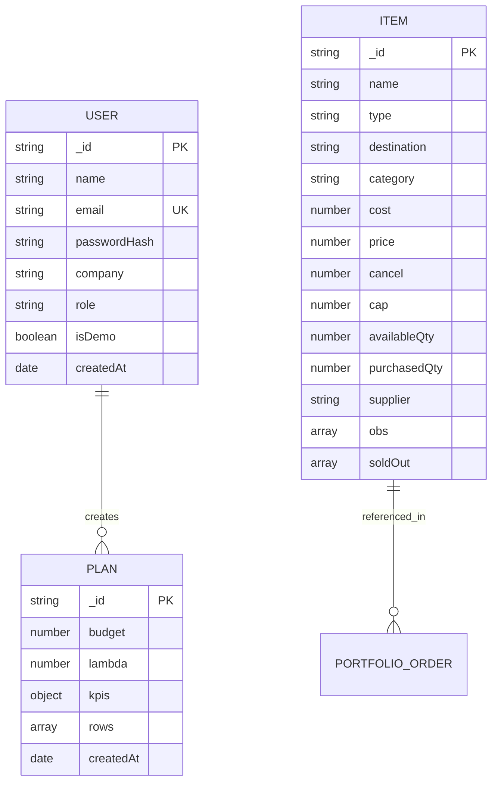

<div align="center">

# ✈️ StockPilot AI

### *Smarter Travel Inventory Buying for Higher Profits.*

An enterprise-grade, AI-powered travel inventory procurement, multi-horizon demand forecasting, risk management, and capital allocation decision-support platform designed for Online Travel Agencies (OTAs), tour operators, hotel procurement directors, and travel inventory managers.

[](https://react.dev/)
[](https://vitejs.dev/)
[](https://nodejs.org/)
[](https://expressjs.com/)
[](https://www.mongodb.com/)
[](https://tailwindcss.com/)
[](https://recharts.org/)
[](https://jwt.io/)

<br />


<br />

[Live Application](#-quick-start--installation) • [Key Features](#-core-functional-modules) • [Mathematical Formulations](#-mathematical-models--algorithms) • [System Architecture](#-system-architecture) • [API Reference](#-api-documentation) • [Demo Account](#-public-demo-account-experience)

---

</div>

## 📌 Table of Contents

- [Overview & Purpose](#-overview--purpose)
- [The Business Problem in Travel Procurement](#-the-business-problem-in-travel-procurement)
- [The StockPilot AI Solution](#-the-stockpilot-ai-solution)
- [Core Functional Modules](#-core-functional-modules)
  - [1. Multi-Horizon AI Demand Forecasting](#1-multi-horizon-ai-demand-forecasting)
  - [2. Empirical Forecast Accuracy & Backtesting](#2-empirical-forecast-accuracy--backtesting)
  - [3. Autonomous Procurement Engine](#3-autonomous-procurement-engine)
  - [4. Newsvendor Economic Order Quantity Optimizer](#4-newsvendor-economic-order-quantity-optimizer)
  - [5. Greedy Fractional Knapsack Budget Optimizer](#5-greedy-fractional-knapsack-budget-optimizer)
  - [6. Travel Inventory Catalog Management](#6-travel-inventory-catalog-management)
  - [7. Perishable Spoilage & Downside Risk Analysis](#7-perishable-spoilage--downside-risk-analysis)
  - [8. What-If Business Scenario Simulator](#8-what-if-business-scenario-simulator)
  - [9. Supplier Intelligence & Reliability Scoring](#9-supplier-intelligence--reliability-scoring)
  - [10. Committed Inventory Portfolio Ledger](#10-committed-inventory-portfolio-ledger)
  - [11. Executive Audit Reports & CSV Export](#11-executive-audit-reports--csv-export)
  - [12. Real-Time Market Alerts & Notifications](#12-real-time-market-alerts--notifications)
- [Visual Design & Aesthetic](#-visual-design--aesthetic)
- [System Architecture](#-system-architecture)
- [Mathematical Models & Algorithms](#-mathematical-models--algorithms)
- [Technology Stack](#-technology-stack)
- [Database Design & Schemas](#-database-design--schemas)
- [API Documentation](#-api-documentation)
- [Public Demo Account Experience](#-public-demo-account-experience)
- [Project Directory Structure](#-project-directory-structure)
- [Quick Start & Installation](#-quick-start--installation)
- [Security & Data Protection](#-security--data-protection)
- [Future Roadmap](#-future-roadmap)
- [License](#-license)

---

## 🎯 Overview & Purpose

> ⚠️ **Important Clarification:** **StockPilot AI is NOT a financial stock trading or equity market platform.**  
> It is an enterprise B2B SaaS decision-support system built specifically for the **travel and tourism industry** to optimize the wholesale purchasing and revenue management of **perishable travel inventory** (hotel room blocks, chartered flight seats, resort villas, and tour packages).

In the travel industry, procurement buyers commit tens of millions of rupees in upfront capital months before the travel season begins. Making these decisions via gut feeling or static spreadsheets routinely leads to either severe **unsold inventory spoilage** or **unmet demand lost profits**.

**StockPilot AI** replaces guesswork with automated, mathematically proven operational research algorithms. It unifies **104-week time-series seasonality forecasting**, **Newsvendor economic risk modeling**, and **greedy fractional knapsack budget allocation** into a unified, executive-grade procurement dashboard.

---

## 💥 The Business Problem in Travel Procurement

Unlike durable retail goods, travel inventory is **strictly perishable**:
- An unsold hotel room cannot be sold tomorrow; once midnight passes, its revenue potential drops to **zero**.
- An empty airline seat at takeoff is a **100% loss of underwritten capital**.
- Travel demand exhibits extreme non-linear fluctuations driven by seasonal holidays, weather, school vacations, and macroeconomic shifts.
- Procurement teams operate under **hard working-capital budget ceilings** and cannot purchase every available contract.
- Buyers face an asymmetric trade-off:
  - **Underage Cost ($C_u$):** Ordering too conservatively leads to sold-out inventory, turning away lucrative bookings and forfeiting market share.
  - **Overage Cost ($C_o$):** Ordering too aggressively leads to perishable overstock that must be dumped at heavy distress discounts or liquidated below cost.

---

## 💡 The StockPilot AI Solution

StockPilot AI bridges the gap between historical market observations and capital allocation:

```mermaid
flowchart LR
    A[Historical Booking Data<br/>104 Weeks] --> B[Time-Series Filter<br/>Seasonality & Trend]
    B --> C[Probabilistic Forecast<br/>P10 / P50 / P90]
    C --> D[Newsvendor Model<br/>Critical Ratio & Salvage Floor]
    D --> E[Knapsack Capital Allocator<br/>Max Marginal Profit/Rupee]
    E --> F[Actionable Decisions<br/>PRE-BUY | BUY PARTLY | SKIP]
    F --> G[Portfolio Ledger &<br/>Audit Export]
```

By balancing marginal expected profits against downside risk penalties under fixed capital budgets, StockPilot AI enables travel businesses to achieve:
1. **+20% to +35% Higher Net Margins** by pre-buying high-confidence, high-margin inventory blocks.
2. **Up to 70% Reduction in Unsold Spoilage Risk** through intelligent critical ratio thresholds.
3. **95%+ Capital Clearance Rates** across diverse portfolios of hotels, flights, and luxury resort villas.

---

## 🚀 Core Functional Modules

### 1. Multi-Horizon AI Demand Forecasting
- **104-Week Empirical Baseline:** Analyzes up to two full years of historical weekly booking volume to capture multi-cycle seasonality.
- **Censored Capacity Normalization:** Automatically identifies historical sold-out weeks where demand was artificially capped by available inventory, reconstructing true underlying consumer demand.
- **P10 / P50 / P90 Confidence Intervals:** Renders interactive confidence bounds:
  - **P10 (Bearish Floor):** 90% probability that demand will exceed this level (conservative baseline).
  - **P50 (Median Expected):** Expected modal demand baseline for procurement planning.
  - **P90 (Bullish Peak):** 10% probability demand surges to this peak during holiday spikes.
- **Dynamic Horizon Slider:** Toggleable forecasts across 4 to 12 forward-looking weeks.

### 2. Empirical Forecast Accuracy & Backtesting
- **26-Week Historical Holdout:** Validates models by running historical backtests against the most recent 26 weeks of observed performance.
- **Standardized Metrics:**
  - **MAE (Mean Absolute Error):** Measures average absolute deviation in units.
  - **RMSE (Root Mean Squared Error):** Penalizes large outlier forecasting errors.
  - **MAPE (Mean Absolute Percentage Error):** Normalized percentage error across all volume scales.
  - **Accuracy Score (%):** Executive accuracy percentage ($100 - \text{MAPE}$).
- **Visual Backtest Curves:** Interactive line charts plotting actual observed bookings directly against predicted trajectories.

### 3. Autonomous Procurement Engine
- **Automated Deal Triage:** Evaluates wholesale contract opportunities and tags each with a definitive recommendation:
  - 🟢 **PRE-BUY:** Underwrite 95%+ of capacity early at wholesale discounts due to high margins and low spoilage risk.
  - 🟡 **BUY PARTLY:** Procure a calculated fractional quota to satisfy high-probability demand while leaving uncertain upside to spot markets.
  - 🔴 **SKIP:** Reject procurement commitments where cancellation exposure or low margins yield negative risk-adjusted expected profit.
- **Plain-English Rationales:** Every decision is accompanied by an audit rationale (e.g., *"+12% YoY growth; 14 sold-out backtest weeks; error ±38 units/wk"*).
- **1-Click Portfolio Commitment:** Directly underwrites approved contracts into the live portfolio ledger.

### 4. Newsvendor Economic Order Quantity Optimizer
- **Economic Parameter Formulation:** Evaluates underage cost ($C_u$), overage cost ($C_o$), and optimal critical ratio service levels ($CR$).
- **Cancellation Slippage Adjustment:** Deducts expected cancellation revenue drag ($P \cdot (1 - 0.5 \cdot \text{CancelRate})$).
- **25% Salvage Recovery Floor:** Models distressed liquidation recovery value on perishable inventory.
- **Interactive Sandbox:** Sliders for cost, price, cancellation rate, salvage floor, demand mean, and standard deviation with real-time recalculation of optimal purchase quantities ($Q^*$).

### 5. Greedy Fractional Knapsack Budget Optimizer
- **Capital Budget Constraint:** Allocates capital across multiple inventory deals within a fixed working capital ceiling (adjustable from **₹1 Cr to ₹50 Cr**).
- **Risk-Aversion Coefficient ($\lambda$):** Allows CFOs and procurement directors to tune risk tolerance from **Aggressive** ($\lambda = 0.1$) to **Balanced** ($\lambda = 0.4$) to **Capital-Preserving** ($\lambda = 0.9$).
- **Marginal Expected Profit per Rupee:** Implements a discrete greedy knapsack solver that allocates each marginal rupee to the deal offering the highest incremental risk-adjusted yield.

### 6. Travel Inventory Catalog Management
- **Multi-Category Asset Directory:** Manages contracts across Hotel Rooms, Flight Seats, Overwater Villas, and Luxury Island Resorts.
- **Full CRUD Support:** Add, edit, inspect, and remove opportunities with instantaneous UI synchronization.
- **Wholesale Financial Metadata:** Tracks supplier identity, cost per unit, retail selling price, maximum capacity caps, contracted quantities, and travel validity dates.

### 7. Perishable Spoilage & Downside Risk Analysis
- **Perishable Exposure Scoring:** Categorizes capital into low, moderate, and high-risk tranches.
- **Salvage Liquidation Curves:** Visualizes recovery value trajectories under varying cancellation and no-show rates.
- **Financial Downside VaR:** Estimates maximum expected capital loss in bearish demand conditions.

### 8. What-If Business Scenario Simulator
- **Interactive Market Stress-Testing:** Simulates macro shocks across 4 independent axes:
  - **Demand Shock:** $-40\%$ recession to $+50\%$ travel boom.
  - **Supplier Cost Inflation:** $-20\%$ wholesale discounts to $+40\%$ supplier price hikes.
  - **Retail Selling Price:** Adjust consumer-facing prices to test price elasticity.
  - **Cancellation Volatility:** Simulate weather disruptions or geopolitical shifts.
- **Side-by-Side KPI Deltas:** Displays spent delta, profit delta, unsold inventory delta, and sell-through rate shifts against the baseline plan with comparative bar charts.

### 9. Supplier Intelligence & Reliability Scoring
- **Supplier Directory:** Deep profiles of vetted hotel chains, charter airlines, and DMC partners (Royal Palms, Gulf Aviation, Siam Skyway, Heritage Rajputana, Atoll Marine, Backwater Serenity).
- **Reliability Index (0–100):** Historical on-time room release and flight seat fulfillment scores.
- **Underwriting Exposure:** Live tracking of total capital underwritten per supplier and delivery risk ratings (`LOW` / `MODERATE`).

### 10. Committed Inventory Portfolio Ledger
- **Active Contract Ledger:** Real-time financial tracker for executed wholesale purchase commitments.
- **Performance Tracking:** Monitors total committed capital, expected revenue, projected profit, and contract timestamps.

### 11. Executive Audit Reports & CSV Export
- **Financial Audit Summary:** Formatted tabular view of all active procurement opportunities, demand baselines, allocations, and sell-through rates.
- **1-Click CSV Export:** Generates clean, timestamped CSV reports ready for Excel, Google Sheets, or ERP import.

### 12. Real-Time Market Alerts & Notifications
- **Automated Signal Feed:** Alerts procurement directors to Q4 holiday demand spikes, Newsvendor critical ratio adjustments, and budget optimization runs.
- **Mark-as-Read & Dismissal:** Interactive management with unread badge indicators.

---

## 🎨 Visual Design & Aesthetic

StockPilot AI adheres to a **Warm Editorial Travel SaaS** design system:

| Design Dimension | Implementation Detail |
| :--- | :--- |
| **Primary Background** | Warm Ivory (`#FAF7F0`) & Secondary Cream (`#F4EBDD`) |
| **Primary Brand Green** | Forest Green (`#145C38`), Deep Forest (`#10452C`), Soft Sage (`#EAF7EE`) |
| **Accent Color** | Warm Sunburst Amber / Orange (`#F29A38`) |
| **Typography** | Editorial Serif Headings (*DM Serif Display / Georgia*) with clean geometric sans-serif (*Inter*) for data tables, metrics, and forms |
| **Card Styling** | Rounded 16–24px borders, subtle warm borders (`#E8E2D7`), soft ambient elevation shadows |
| **Data Visualizations** | Elegant Recharts compositions with bespoke emerald and amber color scales |
| **Clean Public View** | Public landing page focused strictly on product value storytelling; **no cluttered KPI strips on the public homepage** |

---

## 🏗️ System Architecture

StockPilot AI is designed with an enterprise, decoupled architecture featuring an **Autonomous Client-Side Fallback Engine** that ensures 100% platform availability even during backend network timeouts or offline environments.



---

## 📐 Mathematical Models & Algorithms

StockPilot AI implements rigorous quantitative models derived from operations research and supply chain economics:

### 1. Multi-Season Time-Series Forecasting
For historical demand week $t \in [1, 104]$ with base demand $b$, trend slope $tr$, seasonal amplitude $a$, phase $\phi$, and volatility $v$:
$$\mu_t = b \cdot \left(1 + \frac{tr \cdot t}{104}\right) \cdot \left(1 + a \cdot \sin\left(\frac{2\pi(t + \phi)}{52}\right)\right)$$
$$D_t = \mu_t \cdot (1 + v \cdot \epsilon_t), \quad \epsilon_t \sim \mathcal{N}(0, 1)$$

Observed demand $O_t$ is censored at effective capacity limit $W_c$:
$$O_t = \max(5, \min(D_t, W_c))$$

The local seasonal baseline is smoothed across 3-week moving windows, scaled by annual growth factor $g(t)$:
$$S_t = \frac{O_{t-1} + O_t + O_{t+1}}{3}, \quad g(t) = \frac{\overline{O}_{[t-8, t]}}{\overline{O}_{[t-60, t-52]}}$$

### 2. Multi-Horizon Confidence Bounds
Forecasting $h \in [1, 12]$ forward weeks with residual backtest error standard deviation $\sigma$:
$$P50_h = \text{round}(S_{52+h} \cdot g(104))$$
$$P10_h = \max(0, \text{round}(P50_h - 1.28 \cdot \sigma))$$
$$P90_h = \text{round}(P50_h + 1.28 \cdot \sigma)$$

### 3. Newsvendor Economic Critical Ratio
The optimal probability of not stocking out balances the cost of unmet demand ($C_u$) against the cost of unsold inventory ($C_o$):
$$C_u = P \cdot (1 - 0.5 \cdot \text{CancelRate}) - C$$
$$C_o = C - 0.25 \cdot C = 0.75 \cdot C \quad (\text{reflecting a 25\% salvage recovery floor})$$
$$CR = \frac{C_u}{C_u + C_o}$$

The optimal unconstrained procurement quantity $Q^*$ is obtained via the inverse standard normal cumulative distribution function $\Phi^{-1}$:
$$Q^* = \mu + \Phi^{-1}(CR) \cdot \sigma_H, \quad \sigma_H = \sigma \sqrt{12}$$

### 4. Expected Shortfall & Risk-Adjusted Profit
Given purchase quantity $q$, expected sales $s(q)$ and unsold units $u(q)$ are evaluated using the standard normal probability density $\phi(z)$ and loss function:
$$z = \frac{q - \mu}{\sigma_H}, \quad L(q) = \sigma_H \cdot (\phi(z) - z \cdot (1 - \Phi(z)))$$
$$s(q) = \min(q, \max(0, \mu - L(q))), \quad u(q) = \max(0, q - s(q))$$

Risk-adjusted objective function with risk-aversion penalty $\lambda \in [0, 1]$:
$$J(q) = \text{Revenue}(s) + \text{Salvage}(u) - \text{Cost}(q) - \lambda \cdot 0.6 \cdot C \cdot u(q)$$

### 5. Greedy Marginal Knapsack Allocator
To allocate total working capital budget $B$, StockPilot AI discretizes allocations in increments $\Delta q_i = \max\left(1, \text{round}\left(\frac{B}{350 \cdot C_i}\right)\right)$ and iteratively selects opportunity $i^*$ that maximizes the marginal efficiency:
$$i^* = \arg\max_i \left( \frac{J_i(q_i + \Delta q_i) - J_i(q_i)}{\Delta q_i \cdot C_i} \right) \quad \text{subject to } \sum_{i} q_i C_i \le B$$

---

## 💻 Technology Stack

| Layer | Technology | Version | Purpose in StockPilot AI |
| :--- | :--- | :--- | :--- |
| **Frontend Framework** | **React** | `18.3.1` | Component hierarchy, hooks, state management |
| **Build Tool** | **Vite** | `5.4.0` | Hot module replacement, asset bundling, ES modules |
| **Routing** | **React Router DOM** | `7.18.6` | Client-side routing, protected app layout |
| **Visual Charts** | **Recharts** | `3.11.0` | Multi-band demand tunnels, historical lines, donuts |
| **Styling** | **Tailwind CSS** | `3.4` | Responsive utilities, editorial grid layouts |
| **Iconography** | **Lucide React** | `1.77.0` | Premium travel and analytics iconography |
| **Micro-Interactions** | **Canvas Confetti** | `1.9.4` | Celebratory instant-demo and order feedback |
| **Backend Runtime** | **Node.js** | `18+` | Server execution environment |
| **Web Framework** | **Express.js** | `4.19.2` | REST API routes, JSON parsing, CORS headers |
| **Database ODM** | **Mongoose** | `8.5.1` | MongoDB document validation and schema modeling |
| **Database** | **MongoDB** | `6.0+` | NoSQL document storage (with auto in-memory fallback) |
| **Authentication** | **JSON Web Tokens (JWT)** | `9.0.3` | Cryptographic session tokens with 7-day expiration |
| **Password Security** | **Bcrypt.js** | `3.0.3` | Salted credential hashing (10 rounds) |
| **Environment** | **Dotenv** | `16.4.5` | Environment variable management |

---

## 🗄️ Database Design & Schemas



---

## 🔌 API Documentation

All REST endpoints are served relative to `/api` (or proxied via Vite at `http://localhost:5174/api`):

| Method | Endpoint | Auth | Purpose | Request Body / Parameters |
| :--- | :--- | :--- | :--- | :--- |
| `GET` | `/api/health` | Public | System status & DB connectivity | None |
| `POST` | `/api/auth/demo` | Public | **Instant 1-Click Demo Login** | None |
| `POST` | `/api/auth/login` | Public | User authentication & JWT issuance | `{ email, password }` |
| `POST` | `/api/auth/register` | Public | Enterprise account signup | `{ name, email, password, company }` |
| `GET` | `/api/auth/me` | Bearer | Current user session profile | Headers: `Authorization: Bearer <token>` |
| `POST` | `/api/demo/reset` | Public | Restore sample demo database | None |
| `GET` | `/api/inventory` | Public | Get all 8 travel inventory assets | None |
| `POST` | `/api/inventory` | Public | Create custom inventory contract | `{ name, type, cost, price, cancel, cap, supplier, description }` |
| `DELETE`| `/api/inventory/:id`| Public | Delete inventory asset (safe guarded) | URL Param: `id` |
| `POST` | `/api/plan` | Public | Execute Knapsack budget optimization | `{ budget: 100000000, lambda: 0.4 }` |
| `GET` | `/api/accuracy` | Public | 26-week backtest accuracy (MAE/RMSE/MAPE) | None |
| `POST` | `/api/newsvendor` | Public | Standalone Newsvendor calculator | `{ cost, price, cancelRate, salvageRate, mean, sd }` |
| `POST` | `/api/simulate` | Public | Scenario shock simulator | `{ budget, lambda, demandDeltaPct, costDeltaPct, priceDeltaPct, cancelDeltaPct }` |
| `GET` | `/api/suppliers` | Public | Supplier directory & ratings | None |
| `GET` | `/api/portfolio` | Public | Committed contracts ledger | None |
| `POST` | `/api/portfolio/order`| Public | Underwrite order into portfolio | `{ destination, category, units, cost, price, expectedProfit }` |
| `GET` | `/api/notifications`| Public | Live demand & critical alerts | None |
| `POST` | `/api/notifications/mark-read`| Public | Mark alerts as read | None |

---

## ⚡ Public Demo Account Experience

StockPilot AI includes a dedicated, frictionless **Demo Mode** specifically designed for interviewers, recruiters, and prospective enterprise clients:

1. **1-Click Instant Demo Login**:
   - On the Landing Page hero, click **"Try Live Demo"** to authenticate instantly without typing credentials or filling out sign-up forms.
   - On the Split-Screen Login page (`/login`), click **"Explore StockPilot AI Demo"** or click the **"⚡ Autofill Credentials"** chip.
2. **Pre-Seeded Credentials**:
   - **Email:** `demo@stockpilot.ai`
   - **Password:** `demo123`
3. **Demo Safeguards**:
   - **Isolated Session State:** All additions, deletions, and commitments are safe and sandboxed.
   - **Destructive Deletion Barrier:** Prevents deleting below 3 core deals, ensuring forecasting models and charts never render empty states.
   - **1-Click Demo Reset:** Click **"Reset Demo Data"** on the top banner at any time to restore the pristine baseline market.

---

## 📂 Project Directory Structure

```text
stockpilot-mern/
├── docs/
│   └── screenshots/
│       └── hero-banner.jpg          # High-resolution platform overview visual
├── client/                          # React 18 + Vite Frontend Application
│   ├── public/
│   │   ├── hero-travel-banner.jpg   # Brand hero graphic with floating metrics
│   │   └── stockpilot_demo.mp4      # Custom 8-scene H.264 product walkthrough video
│   ├── src/
│   │   ├── components/
│   │   │   ├── AppLayout.jsx        # Sticky sidebar, topbar, & Demo Mode banner
│   │   │   ├── Navbar.jsx           # Public responsive landing navigation
│   │   │   ├── Footer.jsx           # Corporate travel-tech footer
│   │   │   ├── Logo.jsx             # Official emerald airplane logo
│   │   │   ├── NewsvendorModal.jsx  # Interactive mathematical formula guide
│   │   │   └── WatchDemoModal.jsx   # Custom 8-scene video player modal
│   │   ├── context/
│   │   │   └── AuthContext.jsx      # JWT session management & instant demo login
│   │   ├── pages/
│   │   │   ├── LandingPage/
│   │   │   │   └── LandingPage.jsx  # Option 1 travel SaaS landing page
│   │   │   ├── Auth/
│   │   │   │   ├── Login.jsx        # Split-screen login with visual panel
│   │   │   │   └── Signup.jsx       # Enterprise registration page
│   │   │   └── Dashboard/
│   │   │       ├── Overview.jsx     # Executive KPI overview & multi-band charts
│   │   │       ├── Forecasting.jsx  # Time-series demand forecasting (P10/P50/P90)
│   │   │       ├── ForecastAccuracy.jsx # Empirical backtesting (MAE, RMSE, MAPE)
│   │   │       ├── Inventory.jsx    # Inventory catalog CRUD management
│   │   │       ├── Procurement.jsx  # PRE-BUY, BUY PARTLY, SKIP recommendation engine
│   │   │       ├── NewsvendorOptimizer.jsx # Standalone Newsvendor calculator
│   │   │       ├── BudgetOptimizer.jsx # Greedy knapsack capital allocator
│   │   │       ├── ScenarioSimulator.jsx # Macro shock & sensitivity tester
│   │   │       ├── SupplierIntelligence.jsx # Supplier ratings & reliability index
│   │   │       ├── RiskAnalysis.jsx # Spoilage risk & salvage liquidation floors
│   │   │       ├── Portfolio.jsx    # Underwritten purchase contract ledger
│   │   │       ├── Reports.jsx      # Audit tables & 1-click CSV export
│   │   │       ├── Notifications.jsx# Real-time demand surge & critical alerts
│   │   │       └── Settings.jsx     # Profile & Newsvendor risk parameters
│   │   ├── services/
│   │   │   ├── api.js               # Unified API client with timeout fallbacks
│   │   │   └── demoEngine.js        # Autonomous client-side mathematical simulator
│   │   ├── App.jsx                  # Route definitions
│   │   ├── main.jsx                 # Client entry point
│   │   └── styles.css               # Global typography, color variables, & utilities
│   ├── package.json
│   └── vite.config.js               # Vite configuration with /api reverse proxy
└── server/                          # Node.js + Express Backend
    ├── lib/
    │   └── model.js                 # Pure mathematical forecasting & knapsack library
    ├── models/
    │   ├── Item.js                  # Mongoose inventory asset schema
    │   ├── Plan.js                  # Mongoose budget allocation schema
    │   └── User.js                  # Mongoose user authentication schema
    ├── index.js                     # Express server & REST API endpoints
    ├── seed.js                      # MongoDB seed script
    ├── package.json
    ├── .env                         # Local environment configuration
    └── .env.example                 # Example environment template
```

---

## 🛠️ Quick Start & Installation

### Prerequisites
- **Node.js**: `v18.0.0` or higher ([Download Node.js](https://nodejs.org/))
- **npm**: `v9.0.0` or higher
- **MongoDB** *(Optional)*: Runs seamlessly with local/cloud MongoDB or falls back automatically to its self-healing in-memory engine.

### 1. Clone the Repository
```bash
git clone https://github.com/your-username/stockpilot-mern.git
cd stockpilot-mern
```

### 2. Configure Environment Variables
Inside the `server/` directory, create a `.env` file (or copy `.env.example`):
```bash
cd server
cp .env.example .env
```
Default configuration:
```env
PORT=5000
JWT_SECRET=stockpilot_secret_key_2026
MONGO_URI=mongodb://127.0.0.1:27017/stockpilot
```
*(If MongoDB is not running locally, the server logs a notice and operates seamlessly in high-speed in-memory mode).*

### 3. Install Dependencies
Open two terminal windows:

**Terminal 1 (Backend Server):**
```bash
cd server
npm install
npm run dev
```
*Server starts at `http://localhost:5000`.*

**Terminal 2 (Frontend Client):**
```bash
cd client
npm install
npm run dev
```
*Client starts at `http://localhost:5174`.*

### 4. Open Application
Navigate to **`http://localhost:5174`** in your browser.  
Click **"Try Live Demo"** to access the full platform immediately.

---

## 🔒 Security & Data Protection

- **Cryptographic Password Hashing:** User passwords are never stored in plaintext; salted with 10 rounds using `bcryptjs`.
- **Stateless JWT Tokens:** Authenticated requests use cryptographically signed JSON Web Tokens (HMAC-SHA256) with a 7-day expiration.
- **Protected Client Routing:** Client-side routes verify active authentication state and redirect unauthenticated requests to `/login`.
- **Input Sanitization & Range Clamping:** Numerical inputs for budget ceilings ($B$), risk parameters ($\lambda$), and cancellation rates are bounded to prevent division-by-zero or memory overflow.
- **Sandboxed Demo Mutations:** Public demo visitors can test adding and deleting items without risk of purging the database or exposing private accounts.

---

## 🗺️ Future Roadmap

- [x] **Phase 1 — Core Economic Engine (Completed):** 104-week demand forecasting, Newsvendor critical ratio, greedy knapsack capital optimizer.
- [x] **Phase 2 — Enterprise Dashboard (Completed):** 14 fully integrated modules, Option 1 Warm Editorial aesthetic, CSV exports, scenario simulation.
- [x] **Phase 3 — Instant Demo System (Completed):** 1-click demo access, split-screen login redesign, client-side autonomous demo engine.
- [ ] **Phase 4 — Deep Learning & LLM Integration (Planned):** Transformer-based time-series forecasting (Chronos/PatchTST) and generative Natural Language RFP generation.
- [ ] **Phase 5 — Live GDS & Channel Manager Connectors (Planned):** Direct two-way API integrations with Amadeus, Sabre, and Hotelbeds.
- [ ] **Phase 6 — Multi-Tenant SaaS & RBAC (Planned):** Role-based access control (Procurement Buyer, CFO, Auditor) with organization isolation.

---

## 📄 License

This project is currently maintained for development and demonstration purposes. Licensing terms are subject to final determination upon commercial release. Please contact the repository owner regarding distribution, commercial use, or fork permissions.

---

<div align="center">

**StockPilot AI** · *Built with precision for the future of travel revenue management.*

</div>
